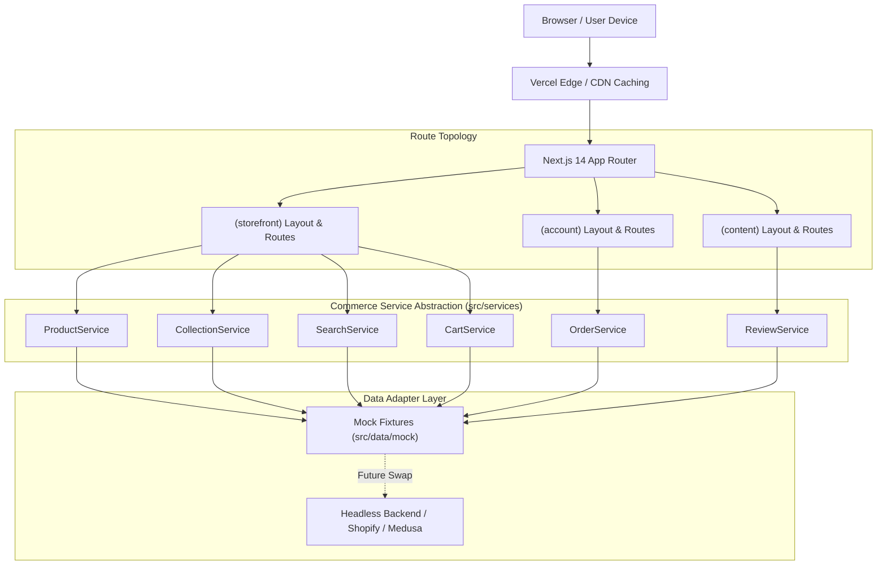

# KRAK & CO. — Application Architecture Specification

**Project:** KRAK & CO. E-Commerce Storefront  
**Phase:** 07 — Next.js Architecture, Folder Structure, Routing & Data Layer  
**Framework:** Next.js 14.2 (App Router)  
**Date:** November 2026  

---

## 1. Architectural Philosophy

The KRAK & CO. storefront is engineered for performance, cultural visual richness, and conversion optimization. The architecture reflects modern e-commerce requirements:

- **Server-First by Default:** All catalog, category, editorial, and metadata operations leverage React Server Components (RSC) to maximize SEO, eliminate client-side waterfall fetching, and minimize initial JavaScript bundle size.
- **Client Components for Interactivity Only:** Client components are reserved strictly for interactive user boundaries (e.g. quantity selectors, cart slide-over drawer, search query typing, checkout payment switches).
- **Service Abstraction Layer:** All commerce domain logic (products, collections, cart, orders, reviews) is decoupled behind a unified asynchronous service interface (`src/services/*`). Switching from mock fixtures to Shopify Storefront API, MedusaJS, or a headless backend requires zero refactoring of UI components or page routes.
- **Type-Driven Domain Modeling:** Data integrity is governed by TypeScript strict mode types located in `src/types/*`. No `any` types or loose records are permitted.

---

## 2. High-Level System Architecture Diagram

---

## 3. Layered Architecture Breakdown

### 3.1 Presentation Layer (`src/app/`, `src/components/`)
- **Server Components:** Fetch domain data through async service calls at the page root and stream pre-rendered HTML to the client with zero bundle penalty.
- **Client Components:** Hydrate interactive controls (cart toggle, weight pack selector, live search input, address editor).

### 3.2 Service Layer (`src/services/`)
- Encapsulates business logic, data normalization, filtering, pricing calculations, and tax computations.
- Exposes typed Promises returning domain objects (`Product`, `Collection`, `Cart`, `Order`).
- In Phase 07, services read from in-memory structured fixtures (`src/data/mock/`).
- Designed with dependency injection potential for production headless backends.

### 3.3 Domain Data Model (`src/types/`)
- Centralized entity declarations.
- Enforces strict invariants:
  - Non-negative pricing in Indian Rupees (`INR`).
  - Strict enum-like unions for regional origin (`south-indian` | `north-indian` | `pan-indian`).
  - Explicit dietary flags (`isVegetarian`, `isVegan`, `isGlutenFree`).
  - Standardized weight package choices (`100g`, `250g`, `500g`, `1kg`).

### 3.4 Infrastructure & Styling Layer (`src/app/globals.css`, `tailwind.config.ts`)
- Design tokens defined in Phase 04 are mapped directly into Tailwind utility classes:
  - Brand colors: `brand-cream`, `brand-maroon`, `brand-mustard`, `brand-forest`, `brand-terracotta`.
  - Fonts: Google Fonts `Playfair Display` (headings) and `Poppins` (body UI).
  - Elevation & Borders: `shadow-card`, `border-surface-sand`.

