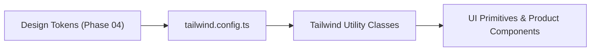

# KRAK & CO. — Component Styling & Design Token Guidelines

**Project:** KRAK & CO. E-Commerce Storefront  
**Phase:** 08 — Complete Reusable UI Component System  
**Framework:** Tailwind CSS 3.4  

---

## 1. Design Token Architecture

All components consume centralized design tokens mapped from Phase 04 in `tailwind.config.ts`. Direct hex codes or arbitrary inline styles are strictly prohibited.

---

## 2. Color Palette Token Map

| Category | Tailwind Token | Value | Primary Usages |
|---|---|---|---|
| **Brand Primary** | `brand-maroon` | `#6B1D2F` | Primary CTAs, major headings, active tab underlines, primary brand borders |
| **Brand Primary Hover** | `brand-maroon-dark`| `#4D1220` | Hover state for buttons, active item selection |
| **Brand Accent** | `brand-mustard` | `#D99B26` | Secondary buttons, star ratings, promotional badges, discount highlights |
| **Brand Accent Light** | `brand-mustard-light`|`#E8B756` | Hover state for mustard buttons |
| **Regional South** | `brand-forest` | `#1E4D2B` | South Indian Classics cards, stock status tags, vegetarian badge |
| **Regional Accent** | `brand-terracotta`| `#B84A39` | Sale badges, wishlist active heart, spice level indicators |
| **Canvas Background** | `surface-canvas` | `#FBF6EE` | Storefront background tone (warm cream) |
| **Card Surface** | `surface-card` | `#FFFFFF` | Product cards, dialog modals, drawer backgrounds |
| **Border Sand** | `surface-sand` | `#E8DCC8` | Card borders, table dividers, input borders |
| **Text Primary** | `text-primary` | `#2D231E` | High-contrast body text, primary product titles |
| **Text Secondary** | `text-secondary`| `#6B5E55` | Supporting descriptions, timestamps, nutritional info |
| **Text Muted** | `text-muted` | `#96887E` | Form helper copy, strikethrough compare prices |

---

## 3. Typography Hierarchy

1. **Display Headings (`font-display`):**
   - Font family: `Playfair Display`, serif.
   - Used for: Hero titles, Page titles, Section headers, Product names on PDP.
   - Classes: `font-display font-bold text-brand-maroon`.
2. **Body & Interface (`font-sans`):**
   - Font family: `Poppins`, sans-serif.
   - Used for: Product cards, buttons, inputs, badge tags, reviews, navigation.
   - Classes: `font-sans text-sm text-text-primary`.

---

## 4. Spacing, Elevation & Corner Radii

- **Radii:**
  - `rounded-sm` (4px): Badges, tooltips.
  - `rounded-lg` (8px): Inputs, buttons, quantity selectors.
  - `rounded-xl` (12px): Dialogs, product card media containers, radio cards.
  - `rounded-2xl` (16px): Product cards, section cards, modals.
  - `rounded-full` (9999px): Category avatar cards, circular badges, avatar icons.
- **Shadows:**
  - `shadow-xs`: Subtle card boundary separation.
  - `shadow-sm` / `shadow-card`: Product card elevation and hover state.
  - `shadow-lg` / `shadow-xl`: Modal dialogs and toast popups.
  - `shadow-2xl`: Slide-over drawer panels.
- **Matchbox Aesthetic Elements:**
  - Vintage dash border: `border-dashed border-surface-sand`.
  - Gradient hair-line dividers: `bg-gradient-to-r from-transparent via-brand-maroon/20 to-transparent`.
  - Kolam background patterns in promotional cards.

