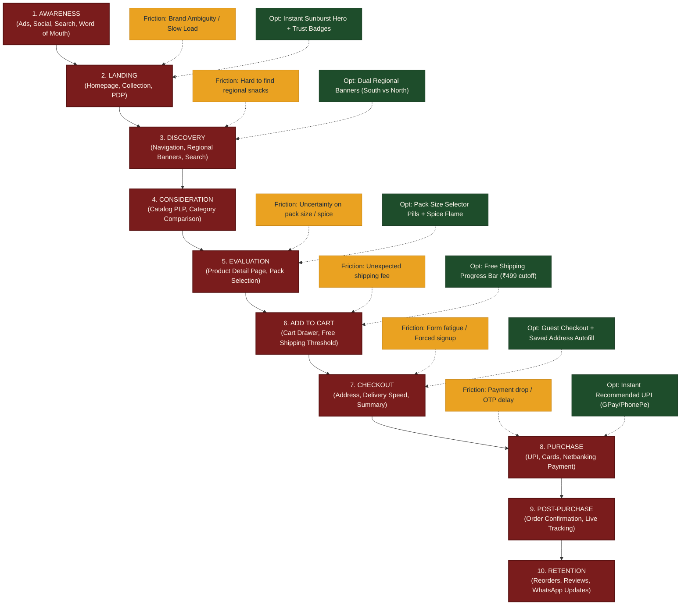

# KRAK & CO. — COMPLETE E-COMMERCE CONVERSION FUNNEL (PHASE 03)

**Document:** 10-Stage Conversion Funnel, Cognitive Friction Points & Optimization Strategy  
**Role:** Lead Conversion Rate Optimization (CRO) Specialist  
**Date:** November 2026

---

## 1. The 10-Stage E-Commerce Conversion Funnel

The KRAK & CO. funnel maps a visitor's psychological transition from first impression to brand advocacy:

---

## 2. Granular Stage-by-Stage Funnel Breakdown

### Stage 1: Awareness
- **Customer Mindset:** Curious, semi-distracted, browsing Instagram or searching for snacks.
- **Customer Questions:** *"What is KRAK & CO.?", "Are these authentic regional snacks?"*
- **Required Information:** Authentic regional positioning, appetizing snack visual, brand hook.
- **Potential Friction:** Mismatched ad scent, confusing branding.
- **Relevant UI Elements:** Ad creative, meta tags, social preview open graph images.
- **Primary CTA:** Click Ad / Link.
- **Secondary CTA:** Save Post.
- **Conversion Opportunity:** Highlighting authentic coconut oil or royal North Indian namkeen recipes.
- **Success Metric:** Ad CTR, organic search impressions.

### Stage 2: Landing
- **Customer Mindset:** Evaluating credibility within the first 3 seconds.
- **Customer Questions:** *"Is this a legitimate brand?", "Where are they located?", "What do they sell?"*
- **Required Information:** Clear value proposition ("Authentic Indian Snacks — South to North"), trust signals.
- **Potential Friction:** Slow page load, generic layout, cluttered visual noise.
- **Relevant UI Elements:** Announcement Bar (`Free Shipping > ₹499`), Hero Banner with sunburst and retro character, Trust Bar (5 value pillars).
- **Primary CTA:** "Shop Now →".
- **Secondary CTA:** "Explore Collections".
- **Conversion Opportunity:** Sub-1.5 second First Contentful Paint (FCP) and immediate visual delight.
- **Success Metric:** Bounce Rate (< 35%), Landing page scroll depth (> 75%).

### Stage 3: Discovery
- **Customer Mindset:** Deciding how to browse (by regional heritage, snack type, or occasion).
- **Customer Questions:** *"Do they have Kerala banana chips?", "Where is the spicy mixture?"*
- **Required Information:** Clear navigational structure, visual category cards.
- **Potential Friction:** Confusing menu taxonomy, hidden search bar, overwhelming options.
- **Relevant UI Elements:** 6 Arch Category Cards, Regional Split Banners (South Indian Green vs North Indian Red), Instant Search modal (`⌘K`).
- **Primary CTA:** "Explore South Indian" / "Explore North Indian".
- **Secondary CTA:** Click Category Arch (e.g. "Chips & Crisps").
- **Conversion Opportunity:** Providing both geographical and functional browsing paths.
- **Success Metric:** Category/Collection CTR (> 40%), Search initiation rate (> 15%).

### Stage 4: Consideration (Product Listing)
- **Customer Mindset:** Comparing varieties, evaluating prices and weights.
- **Customer Questions:** *"Which mixture is spicy?", "How much does a 250g pack cost?"*
- **Required Information:** High-resolution snack imagery, ratings, pack weight, price, spice level.
- **Potential Friction:** Tiny text, missing prices, lack of filters.
- **Relevant UI Elements:** Product Card with Bestseller badge, rating stars (`★ 4.8`), price (`₹149 250g`), quick add button.
- **Primary CTA:** "Add to Cart" (Direct card action).
- **Secondary CTA:** Click card to open PDP.
- **Conversion Opportunity:** Quick Add to Cart for familiar snacks to reduce consideration time.
- **Success Metric:** Product Card Click-Through Rate (> 20%), Quick-Add rate (> 10%).

### Stage 5: Product Evaluation (PDP)
- **Customer Mindset:** High intent; inspecting details, ingredients, and shelf life before committing.
- **Customer Questions:** *"What oil is used?", "Is it fresh?", "Which pack size should I choose?"*
- **Required Information:** Multi-pack selector (`100g`, `250g`, `500g`), ingredients, allergen declaration, trust badges.
- **Potential Friction:** Hidden shipping costs, lack of oil transparency, unreadable ingredient lists.
- **Relevant UI Elements:** Multi-angle gallery, pack size selector pills, quantity stepper `[- 1 +]`, trust pills (*No Preservatives*, *Authentic Recipe*), accordion tabs.
- **Primary CTA:** "Add to Cart" (Solid deep maroon button).
- **Secondary CTA:** "Add to Wishlist" (Heart icon).
- **Conversion Opportunity:** Defaulting to the best-value 250g pack and displaying the savings on the 500g family pack.
- **Success Metric:** PDP-to-Cart Conversion Rate (> 12%).

### Stage 6: Add to Cart & Basket Building
- **Customer Mindset:** Receptive to relevant additions; monitoring delivery fees.
- **Customer Questions:** *"Did my item get added?", "How much more do I need to spend for free shipping?"*
- **Required Information:** Instant confirmation, line-item quantity controls, free shipping threshold indicator.
- **Potential Friction:** Forcing a page reload to `/cart`, hidden delivery charges.
- **Relevant UI Elements:** Slide-over Cart Drawer, Free Shipping Progress Meter (`"Add ₹72 more for Free Shipping"`), 1-click cross-sell snack chips.
- **Primary CTA:** "Proceed to Checkout →".
- **Secondary CTA:** "Add Recommended Snack (+ ₹119)".
- **Conversion Opportunity:** Gamifying the free-shipping threshold to lift Average Order Value (AOV) above ₹500.
- **Success Metric:** Cart Drawer checkout progression (> 65%), Free shipping unlock rate (> 50%).

### Stage 7: Checkout
- **Customer Mindset:** Task-oriented; wants to complete purchase without errors or unexpected costs.
- **Customer Questions:** *"When will this arrive?", "What payment options are available?"*
- **Required Information:** Delivery timeline (3-5 days vs 1-2 days Express), exact tax & shipping breakdown, secure payment badges.
- **Potential Friction:** Mandatory account creation, complex multi-page forms, surprise fees.
- **Relevant UI Elements:** 3-step checkout indicator (1. Address → 2. Delivery → 3. Payment), saved address cards, Indian PIN code auto-fill, guest checkout.
- **Primary CTA:** "Continue to Payment →" / "Pay ₹[Total]".
- **Secondary CTA:** "Back to Shipping" / "Edit Cart".
- **Conversion Opportunity:** Clean, single-page distraction-free layout with zero extraneous header/footer links.
- **Success Metric:** Checkout Start-to-Completion Rate (> 75%).

### Stage 8: Purchase & Payment
- **Customer Mindset:** Cautious; verifying financial security and payment ease.
- **Customer Questions:** *"Will my UPI transaction go through smoothly?"*
- **Required Information:** Supported payment gateways (UPI GPay/PhonePe/Paytm, Credit/Debit cards, Netbanking), clear security seals.
- **Potential Friction:** Failed bank redirects, confusing OTP screens, ambiguous timeout states.
- **Relevant UI Elements:** Prominent UPI recommended selector, auto-suggest UPI apps, credit card inputs with auto-formatting, order total summary.
- **Primary CTA:** "Pay ₹[Total] Securely".
- **Secondary CTA:** Change payment method.
- **Conversion Opportunity:** UPI Deep-linking on mobile for 1-tap payment without manual VPA entry.
- **Success Metric:** Payment gateway success rate (> 95%).

### Stage 9: Post-Purchase & Tracking
- **Customer Mindset:** Reassured, expectant; anticipating arrival of snacks.
- **Customer Questions:** *"Is my order confirmed?", "When will it be dispatched?"*
- **Required Information:** Clear order reference number, delivery window, link to live tracking.
- **Potential Friction:** Ambiguous confirmation, missing receipt or tracking link.
- **Relevant UI Elements:** Order Confirmation screen with celebration icon, 5-stage shipment timeline link, printable invoice, WhatsApp updates opt-in.
- **Primary CTA:** "Track Your Order →".
- **Secondary CTA:** "Continue Shopping".
- **Conversion Opportunity:** Reassuring the buyer immediately reduces customer support tickets and buyer remorse.
- **Success Metric:** Order tracking view rate (> 60%), WhatsApp opt-in rate (> 40%).

### Stage 10: Retention & Repeat Order
- **Customer Mindset:** Satisfied snacker enjoying the product; open to replenishing favorites.
- **Customer Questions:** *"How do I order the exact same snacks again?"*
- **Required Information:** Simple reorder shortcut, seasonal festive reminders.
- **Potential Friction:** Having to find and re-select individual items one by one.
- **Relevant UI Elements:** "1-Click Reorder" in Account Order History, automated post-delivery review prompt, personalized replenishment notifications.
- **Primary CTA:** "Reorder This Box".
- **Secondary CTA:** "Write a Verified Review".
- **Conversion Opportunity:** Frictionless reordering turns a one-time buyer into a high-LTV subscriber.
- **Success Metric:** 60-day repeat purchase rate (> 28%).

