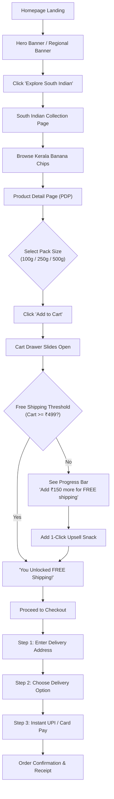
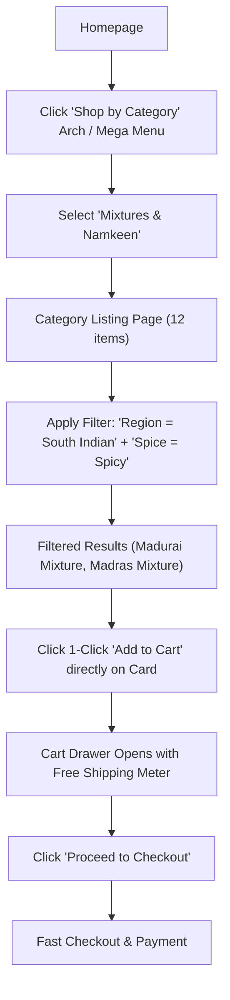
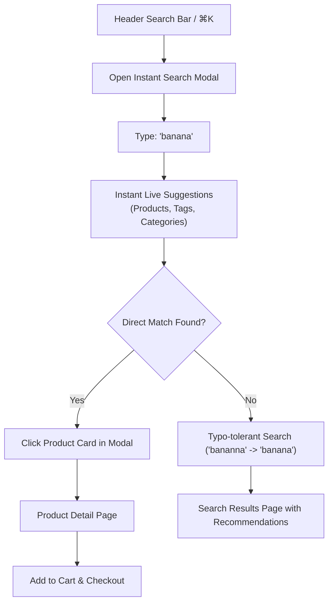
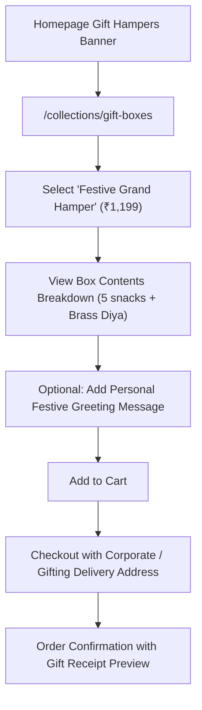
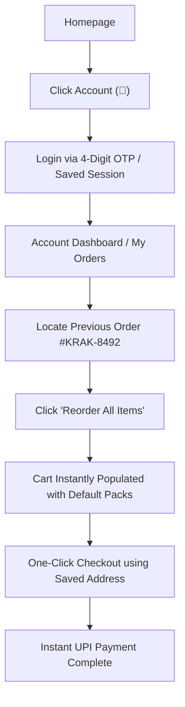
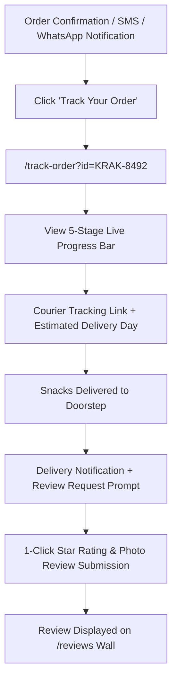

# KRAK & CO. — CUSTOMER JOURNEY MAPS & CRO ANALYSIS (PHASE 02)

**Document:** E-commerce Customer Journeys, Conversion Optimization & Friction Analysis  
**Author:** Conversion Rate Optimization (CRO) Specialist & Customer Journey Architect  
**Date:** November 2026

---

## 1. Overview of Core Personas & Intent Models

The KRAK & CO. storefront caters to four primary customer personas:
1. **The Regional Nostalgia Seeker:** Yearns for authentic taste of home (e.g. Malayalis or Tamilians living across India looking for genuine coconut-oil fried chips or spicy mixture).
2. **The Gourmet Snack Explorer:** Urban food enthusiast looking to upgrade from mass-market industrial snacks to artisanal regional crunch.
3. **The Festive & Corporate Gifter:** Time-sensitive buyer purchasing curated, beautifully packaged gift boxes for Diwali, Pongal, weddings, or corporate clients.
4. **The Habitual Repeat Muncher:** Frequently reorders favorite chai-time savouries with minimal checkout friction.

---

## 2. Customer Journey A: First-Time Customer (Regional Discovery)

### 2.1 Intent & Overview
The visitor lands on the homepage, discovers regional authenticity, explores Southern/Northern specialties, selects a pack size, and completes their initial purchase.

### 2.2 Visual Flowchart

### 2.3 Interaction Mapping & Decision Points
1. **Homepage ➔ Regional Collection:** Customer chooses between South Indian Classics (Green) and North Indian Favourites (Red). Decision driven by cultural preference.
2. **PDP Variant Selection:** Customer evaluates pack size vs value (`100g ₹69` trial size vs `250g ₹149` standard vs `500g ₹279` family savings).
3. **Cart Drawer Free Shipping Prompt:** Psychological trigger: customer prefers adding a ₹119 snack rather than paying ₹49 for shipping.
4. **Checkout Completion:** Minimal form friction with Indian PIN code auto-fill for city/state.

### 2.4 Friction Points & CRO Mitigations
- **Friction 1: Concern over freshness and transit breakage.**  
  *Mitigation:* Prominent trust badges on PDP: "Triple-Layer Nitrogen Packaging", "Crunch Guaranteed", "Zero Preservatives".
- **Friction 2: Mandatory account registration abandonment.**  
  *Mitigation:* Seamless Guest Checkout enabled; phone number captures shipping updates without forcing password creation.

---

## 3. Customer Journey B: Category-Driven Discovery

### 3.1 Intent & Overview
The shopper specifically craves "Mixtures" or "Murukku" and uses the Shop navigation menu or category arches to filter by spice level and price.

### 3.2 Visual Flowchart

### 3.3 Friction Points & CRO Mitigations
- **Friction: Having to open every PDP just to add a snack.**  
  *Mitigation:* Quick "Add to Cart" directly on the product card defaults to the popular 250g pack, enabling rapid multi-snack purchasing in under 30 seconds.

---

## 4. Customer Journey C: Search-Driven Discovery

### 4.1 Intent & Overview
High-intent customer seeking a specific snack name, ingredient, or regional term (e.g. "coconut oil", "ragi", "sev").

### 4.2 Visual Flowchart

### 4.3 Friction Points & CRO Mitigations
- **Friction: Zero-result dead ends when searching for regional dialect spellings (e.g. 'muruku' vs 'murukku').**  
  *Mitigation:* Synonym mapping and fuzzy search normalization in the search service. When zero matches exist, immediately render popular Bestsellers.

---

## 5. Customer Journey D: Gift Box Shopping

### 5.1 Intent & Overview
A festive or corporate shopper seeking premium assorted snack hampers for family or employees.

### 5.2 Visual Flowchart

### 5.3 Friction Points & CRO Mitigations
- **Friction: Uncertainty about what items are inside the sealed hamper.**  
  *Mitigation:* Clear visual breakdown with individual thumbnail pills showing each included snack pack and weight.

---

## 6. Customer Journey E: Returning Customer & Quick Reorder

### 6.1 Intent & Overview
Customer previously bought snacks and wants to reorder their favorite chai-time box in under 60 seconds.

### 6.2 Visual Flowchart

### 6.3 Friction Points & CRO Mitigations
- **Friction: Remembering forgotten passwords.**  
  *Mitigation:* Passwordless mobile OTP or email magic link login.

---

## 7. Customer Journey F: Post-Purchase & Tracking

### 7.1 Intent & Overview
Customer expects timely tracking updates on their snack package and submits feedback upon savoring the crunch.

### 7.2 Visual Flowchart

### 7.3 Friction Points & CRO Mitigations
- **Friction: Anxiety about transit delays for perishable items.**  
  *Mitigation:* Proactive WhatsApp and SMS tracking updates at each dispatch milestone (`Packed`, `Shipped`, `Out for Delivery`).

