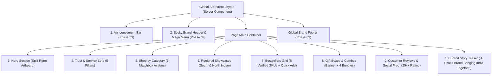

# KRAK & CO. — Complete Homepage Implementation Report

**Project:** KRAK & CO. E-Commerce Storefront  
**Phase:** 10 — Complete Homepage Development & Conversion Optimisation  
**Framework:** Next.js 14.2 App Router, TypeScript 5.6.3, Tailwind CSS 3.4  
**Date:** November 2026  
**Status:** FULLY IMPLEMENTED & VERIFIED  

---

## 1. Architectural Overview

The KRAK & CO. homepage (`src/app/(storefront)/page.tsx`) is built as a high-performance **React Server Component** orchestrating eight conversion-focused sections, backed by the commerce service layer (`productService.getAllProducts()`) and wrapped in the global storefront layout shell (`Header`, `AnnouncementBar`, `Footer`).

---

## 2. Section-by-Section Architecture

### Section 01 & 02: Announcement Bar & Header
- Reused directly from Phase 09.
- Rotating value announcements ("✨ Festive Snack Boxes Now Live! | Free Shipping Above ₹499").
- Sticky navigation bar (`h-20`, `bg-surface-card/95 backdrop-blur-md`) with Mega Menu, Search, Account, Wishlist, and Cart badges.

### Section 03: Hero Section (`src/components/home/HeroSection.tsx`)
- **Visual Composition:** 12-column split layout on deep crimson/maroon gradient (`#6B1D2F` to `#4A101C`) with subtle radial sunburst rays and gold sparkles.
- **Left:** Retro Indian pop-art woman with cat-eye sunglasses, gold jhumkas, gajra, and sari enjoying banana chips (`retro-woman-snacking.svg`).
- **Center:** Bold retro display headline:
  `AUTHENTIC INDIAN SNACKS SOUTH TO NORTH`
  Supporting copy: "Traditional recipes, premium ingredients, and irresistible crunch in every single bite."
  Primary CTA: "Shop Now →" (`/shop`, mustard yellow button).
  Secondary CTA: "Explore Collections" (`/collections/south-indian`, outlined cream button).
- **Right:** Traditional brass urli overflowing with golden banana chips, murukku coils, and mixture (`hero-snack-platter.svg`).

### Section 04: Trust and Service Strip (`src/components/home/TrustStrip.tsx`)
- Five high-contrast benefit pillars:
  1. *Authentic Recipes* (regional, time-tested)
  2. *Premium Ingredients* (no compromise on quality)
  3. *Freshly Packed* (crunch that lasts)
  4. *Pan India Delivery* (to your doorstep)
  5. *Secure Payments* (UPI, Cards, Netbanking)

### Section 05: Shop by Category (`src/components/home/CategorySection.tsx`)
- Six circular avatar cards with vintage matchbox rims:
  - Chips & Crisps (`/collections/chips-crisps`)
  - Mixtures (`/collections/mixtures`)
  - Savouries (`/collections/savouries`)
  - Sweets & Mithai (`/collections/sweets-mithai`)
  - Pickles & Sides (`/collections/pickles-sides`)
  - Gift Boxes (`/gift-boxes`)

### Section 06: Regional Collections Showcase (`src/components/home/RegionalSection.tsx`)
- **South Indian Classics:** Deep forest green card with traditional Temple Gopuram illustration (`illustration-gopuram.svg`), Tamil Nadu / Kerala regional copy, and "Explore South Indian →" CTA.
- **North Indian Favourites:** Deep maroon card with historic Monument illustration (`illustration-monument.svg`), Delhi / Punjab / Rajasthan regional copy, and "Explore North Indian →" CTA.

### Section 07: Bestsellers / Featured Products (`src/components/home/BestsellersSection.tsx`)
- Section heading with diamond starbursts and "View All →" link to `/shop?filter=bestsellers`.
- Five verified product cards matching the reference artboard:
  1. *Kerala Banana Chips* (₹149, 250g, 4.8 ★)
  2. *Madurai Special Mixture* (₹129, 250g, 4.7 ★)
  3. *Crispy Aloo Bhujia* (₹149, 250g, 4.8 ★, Bestseller tag)
  4. *Ragi Sesame Murukku* (₹139, 200g, 4.7 ★)
  5. *Royal Kaju Katli* (₹349, 250g, 4.9 ★)
- Interactive Quick Add to Cart button and Wishlist toggle with instant floating toast feedback.

### Section 08: Gift Boxes & Combos (`src/components/home/GiftBoxesCombosSection.tsx`)
- **Promotional Hamper Banner:** Deep maroon card featuring the open keepsake red gift tin (`retro-gift-tin.svg`), "Festive Gifts / Corporate Gifting / Family Combos" tag pills, "Explore Gift Boxes →" CTA, and retro man snacking illustration (`retro-man-snacking.svg`).
- **Four Curated Bundle Cards:**
  1. *Classic South Combo* (₹699 ₹799)
  2. *North Indian Treat Box* (₹749 ₹849)
  3. *Festive Gift Hamper* (₹1,199 ₹1,499)
  4. *Family Crunch Combo* (₹899 ₹1,049)

### Section 09: Customer Reviews Wall (`src/components/home/ReviewsSection.tsx`)
- "Loved by 25,000+ Snack Lovers Across India" (4.8 / 5.0 from 25,346 verified reviews).
- 3 verified buyer testimonials from Priya S. (Chennai), Arjun M. (Bengaluru), and Nisha R. (Delhi).
- Link to full reviews page (`/reviews`).

### Section 10: Brand Story Teaser (`src/components/home/BrandStorySection.tsx`)
- "About KRAK & CO. — A Snack Brand That Brings India Together."
- Concise narrative on bridging regional snack cultures with pure cold-pressed oils.
- "Our Story →" button navigating to `/about`.

