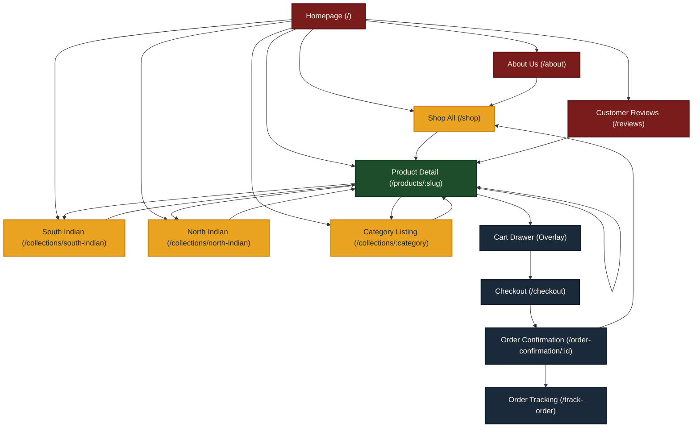

# KRAK & CO. — PAGE RELATIONSHIP SYSTEM & LINKING STRATEGY (PHASE 02)

**Document:** Page Relationships, Internal Linking & Breadcrumb Architecture  
**Author:** Lead Information Architect & SEO Systems Engineer  
**Date:** November 2026

---

## 1. Page Relationship Model

The KRAK & CO. storefront operates as a tightly integrated semantic web where every product, collection, and brand story is mutually reachable through logical, intentional pathways.

---

## 2. Internal Linking Strategy

### 2.1 Cross-Collection Bridges
- On `/collections/south-indian`: A prominent bridge banner invites users to explore Northern snacks: *"Craving Delhi namkeen or spicy Ratlami sev? Explore North Indian Favourites →"*.
- On `/collections/north-indian`: A reciprocal bridge invites users: *"Love coconut oil crunch and authentic murukku? Explore South Indian Classics →"*.
- **CRO Impact:** Prevents regional dead-ends; increases multi-category basket building.

### 2.2 Product Detail Cross-Sells & Pairings
- On `/products/kerala-banana-chips`:
  - Related in Collection: Madurai Mixture, Ragi Murukku.
  - "Pairs Well With": Spiced Chai Mixture, Mango Avakaya Pickle.
  - Included In: Festive South Indian Hamper.
- **CRO Impact:** Boosts Average Order Value (AOV) by providing relevant, contextual pairing suggestions.

### 2.3 Reviews-to-Product Linking
- Every verified review card displayed on `/reviews` contains a direct thumbnail link and "Add to Cart" button for the specific snack reviewed.

---

## 3. Standardized Breadcrumb Hierarchy

Breadcrumbs provide orientation, prevent cognitive disorientation, and pass semantic hierarchy to search engine crawlers.

| View Type | Breadcrumb Schema Format | Example Output |
|---|---|---|
| **Shop All** | `Home > Shop` | `Home > Shop` |
| **Regional Collection**| `Home > Collections > [Region Name]` | `Home > Collections > South Indian Classics` |
| **Category Listing** | `Home > Categories > [Category Name]` | `Home > Categories > Mixtures & Namkeen` |
| **Product Detail** | `Home > [Primary Collection] > [Product Name]` | `Home > South Indian > Kerala Banana Chips` |
| **Gift Boxes** | `Home > Collections > Gift Boxes & Hampers` | `Home > Collections > Gift Boxes & Hampers` |
| **Cart Page** | `Home > Shopping Cart` | `Home > Shopping Cart` |
| **Account Dashboard**| `Home > My Account` | `Home > My Account` |
| **Order History** | `Home > My Account > Order History` | `Home > My Account > Order History` |
| **Specific Order** | `Home > My Account > Order History > #:orderId` | `Home > My Account > Order History > #KRAK-8492` |
| **Policy Page** | `Home > Policies > [Policy Name]` | `Home > Policies > Shipping & Delivery` |

### 3.1 Strict Loop Prevention Rules
1. **Checkout Isolation:** The `/checkout` route purposefully strips global navigation links, footer loops, and breadcrumbs to prevent exit funnel leakage. A simple "Return to Cart" link is the sole backward path.
2. **Post-Order Re-entry:** `/order-confirmation/:id` directs users onward to `/track-order` or back to `/shop`, never back to `/checkout`.
3. **Cart Drawer Closure:** Dismissing the cart drawer returns focus directly to the initiating element on the host page.

