# KRAK & CO. — PRODUCT TAXONOMY SPECIFICATION (PHASE 02)

**Document:** Product Classification, Taxonomy Architecture & Attribute Modeling  
**Author:** Lead Information Architect & Product Data Analyst  
**Date:** November 2026

---

## 1. Taxonomy Philosophy: Multi-Dimensional Discovery

In Indian food commerce, customers discover snacks through orthogonal mental frameworks:
- By **Culinary Geography** (e.g., "I crave authentic Kerala banana chips fried in fresh coconut oil" or "I want Rajasthani spicy bhujia").
- By **Snack Texture & Occasion** (e.g., "I need a crunchy mixture for tea time", "I want soft Mysore pak for dessert").
- By **Dietary & Lifestyle Preference** (e.g., "Gluten-Free", "Jain-Friendly", "No Onion Garlic", "Mild Spice").
- By **Purchase Intent** (e.g., "Everyday 100g snacking" vs. "Festive Premium Gift Hamper").

To support these browsing patterns **without duplicating product entities or inventory records**, KRAK & CO. implements a **poly-hierarchical relational taxonomy**.

---

## 2. Taxonomy Hierarchy & Relationship Diagram

```mermaid
graph TD
    classDef root fill:#7A1C1C,stroke:#581111,stroke-width:2px,color:#FFF8EE;
    classDef dim fill:#EAA221,stroke:#C8830E,stroke-width:2px,color:#1B2A3A;
    classDef cat fill:#FFF8EE,stroke:#7A1C1C,stroke-width:1px,color:#7A1C1C;
    classDef prod fill:#1E4D2B,stroke:#14361E,stroke-width:1px,color:#FFF8EE;

    Catalog["KRAK & CO. Product Catalog"]:::root

    Catalog --> RegionDim["Dimension: Culinary Region"]:::dim
    Catalog --> CategoryDim["Dimension: Snack Category"]:::dim
    Catalog --> OccasionDim["Dimension: Occasion & Gifting"]:::dim

    RegionDim --> SouthInd["South Indian<br/>(Kerala, TN, Karnataka, Andhra)"]:::cat
    RegionDim --> NorthInd["North Indian<br/>(Delhi, Rajasthan, Punjab, Gujarat)"]:::cat
    RegionDim --> PanInd["Pan-Indian / Fusion"]:::cat

    CategoryDim --> Chips["Chips & Crisps"]:::cat
    CategoryDim --> Mixtures["Mixtures & Namkeen"]:::cat
    CategoryDim --> Savouries["Murukku & Savouries"]:::cat
    CategoryDim --> Sweets["Sweets & Mithai"]:::cat
    CategoryDim --> Pickles["Pickles & Sides"]:::cat

    OccasionDim --> GiftBoxes["Gift Boxes & Hampers"]:::cat
    OccasionDim --> Combos["Snack Combos & Bundles"]:::cat
    OccasionDim --> Everyday["Everyday Snacking"]:::cat

    %% Multi-parenting mapping examples
    P1["Kerala Banana Chips (250g)"]:::prod
    SouthInd -.-> P1
    Chips -.-> P1
    Everyday -.-> P1

    P2["Madurai Mixture (250g)"]:::prod
    SouthInd -.-> P2
    Mixtures -.-> P2
    Everyday -.-> P2

    P3["Aloo Bhujia (250g)"]:::prod
    NorthInd -.-> P3
    Mixtures -.-> P3
    Everyday -.-> P3

    P4["Classic South Combo Box"]:::prod
    SouthInd -.-> P4
    Combos -.-> P4
    GiftBoxes -.-> P4
```



---

## 3. Dimension Specifications

### 3.1 Region Taxonomy (`region`)
| Region Code | Display Name | Sub-regions / Heritage | Core Flavor Profile |
|---|---|---|---|
| `south-indian` | South Indian Classics | Kerala, Tamil Nadu, Karnataka, Andhra Pradesh | Pure coconut oil, curry leaves, asafoetida, sesame, rice flour |
| `north-indian` | North Indian Favourites | Delhi, Rajasthan, Punjab, Gujarat, Uttar Pradesh | Besan (chickpea), chaat masala, mint, ajwain, amchur, hing |
| `pan-indian` | Pan-Indian Specialties | National & festive blends | Balanced spices, universal celebratory sweets (Kaju Katli) |

### 3.2 Category Taxonomy (`category`)
| Category Slug | Display Name | Archetype Products | Default Visual Icon |
|---|---|---|---|
| `chips-crisps` | Chips & Crisps | Kerala Banana Chips, Tapioca Chips, Jackfruit Chips | Golden sliced banana chip |
| `mixtures` | Mixtures & Namkeen | Madurai Mixture, Bombay Mixture, Aloo Bhujia, Ratlami Sev | Spiced mixture bowl |
| `savouries` | Murukku & Savouries | Ragi Murukku, Butter Murukku, Thattai, Ribbon Pakoda | Spiral murukku coil |
| `sweets-mithai` | Sweets & Mithai | Mysore Pak, Kaju Katli, Besan Ladoo, Tirunelveli Halwa | Diamond sweet piece |
| `pickles-sides` | Pickles & Sides | Avakaya Mango Pickle, Spiced Gunpowder (Podi), Lime Pickle | Traditional ceramic jar |
| `gift-boxes` | Gift Boxes & Hampers | Classic South Box, North Indian Treat Box, Festive Hampers | Ribbon gift box |
| `combos` | Snack Combos | Chai-Time Trio, South-North Sampler, Crunchy Duo | Snack assortment badge |

---

## 4. Product Attribute Specification (Schema Blueprint)

Each product record is structured with comprehensive, deterministic attributes:

### 4.1 Core Identification
- `id`: Unique invariant alphanumeric identifier (e.g., `prod_kerala_banana_chips`).
- `slug`: URL-safe SEO identifier (e.g., `kerala-banana-chips`).
- `name`: Display title (e.g., `Kerala Banana Chips`).
- `shortDescription`: Punchy 1-sentence value proposition (e.g., `"Crispy, golden banana chips made in traditional Kerala style using premium cold-pressed coconut oil."`).
- `fullDescription`: Detailed story of the recipe, heritage, and texture.

### 4.2 Categorization & Tags (Multi-Collection Assignment)
- `primaryCategory`: Primary classification slug (e.g., `chips-crisps`).
- `secondaryCategories`: Array of associated category slugs (e.g., `['everyday-snacking']`).
- `region`: Origin classification (`south-indian` | `north-indian` | `pan-indian`).
- `tags`: Search & badge keywords (e.g., `['bestseller', 'coconut-oil', 'traditional', 'tea-time']`).
- `isBestseller`: Boolean flag for homepage and filter highlighting.
- `isNew`: Boolean flag for new arrivals.
- `isFeatured`: Boolean flag for promotional banner spots.

### 4.3 Dietary & Culinary Attributes
- `dietaryType`: `100% Vegetarian` (Standard across all KRAK & CO. snacks).
- `spiceLevel`: `Mild` (1/3) | `Medium` (2/3) | `Spicy` (3/3).
- `cookingMedium`: `Pure Coconut Oil` | `Refined Groundnut Oil` | `Pure Desi Ghee`.
- `ingredients`: Array of clear, honest ingredients (e.g., `['Raw Nendran Bananas', 'Cold-Pressed Coconut Oil', 'Rock Salt', 'Turmeric']`).
- `allergens`: Explicit allergen declarations (e.g., `['None']` or `['Processed in a facility that handles nuts and gluten']`).
- `shelfLife`: Days of guaranteed freshness (e.g., `90 Days from packaging`).
- `storageInstructions`: Clear guidance (e.g., `"Store in a cool, dry place. Keep in an airtight container once opened."`).

### 4.4 Variant & Pack Size Structure
Products feature multi-pack options. Each variant maintains its own pricing, weight, and inventory state:

```typescript
interface ProductVariant {
  id: string;               // e.g. "kbc-100g"
  sku: string;              // e.g. "KRAK-KBC-100"
  packSize: string;         // e.g. "100g"
  weightGrams: number;      // e.g. 100
  price: number;            // Current selling price (e.g. 69)
  compareAtPrice?: number;  // Original crossed-out price for discount (e.g. 79)
  inventoryCount: number;   // Stock availability
  isDefault?: boolean;      // Default selected variant
}
```

### 4.5 Imagery & Assets
- `thumbnailUrl`: Optimized square WebP image for product cards and cart thumbnails (400×400px).
- `galleryUrls`: Array of high-resolution lifestyle, packaging, and close-up crunch photos (1000×1000px).
- `badgeUrl`: Associated trust badge (e.g., "Coconut Oil Fried", "Bestseller").

### 4.6 Social Proof & Ratings
- `averageRating`: Aggregate score (e.g., `4.8`).
- `reviewCount`: Total verified reviews count (e.g., `2356`).

---

## 5. Representative Product Classification Examples

### Example 1: Kerala Banana Chips
- **Product ID:** `prod_kerala_banana_chips`
- **Region:** `south-indian`
- **Primary Category:** `chips-crisps`
- **Appears in Collections:** `/shop`, `/collections/south-indian`, `/collections/chips-crisps`, Bestsellers Filter
- **Spice Level:** `Mild`
- **Cooking Medium:** `Pure Cold-Pressed Coconut Oil`
- **Variants:**
  - `100g` @ ₹69
  - `250g` @ ₹149 *(Default & Bestseller)*
  - `500g` @ ₹279 *(Family Pack — 10% Savings)*

### Example 2: Madurai Mixture
- **Product ID:** `prod_madurai_mixture`
- **Region:** `south-indian`
- **Primary Category:** `mixtures`
- **Appears in Collections:** `/shop`, `/collections/south-indian`, `/collections/mixtures`, Bestsellers Filter
- **Spice Level:** `Spicy`
- **Key Ingredients:** Gram flour, fried peanuts, roasted gram, curry leaves, chili powder, garlic pods, asafoetida.
- **Variants:**
  - `250g` @ ₹129 *(Default)*
  - `500g` @ ₹249

### Example 3: Aloo Bhujia
- **Product ID:** `prod_aloo_bhujia`
- **Region:** `north-indian`
- **Primary Category:** `mixtures`
- **Appears in Collections:** `/shop`, `/collections/north-indian`, `/collections/mixtures`, Bestsellers Filter
- **Spice Level:** `Medium`
- **Key Ingredients:** Fresh potatoes, gram flour, tepary bean flour, mint leaves, amchur, clove, rock salt.
- **Variants:**
  - `200g` @ ₹119
  - `400g` @ ₹219

### Example 4: Classic South Indian Festive Gift Hamper
- **Product ID:** `prod_south_festive_hamper`
- **Region:** `south-indian`
- **Primary Category:** `gift-boxes`
- **Secondary Category:** `combos`
- **Appears in Collections:** `/shop`, `/collections/south-indian`, `/collections/gift-boxes`, `/collections/combos`
- **Contents:** Kerala Banana Chips (250g), Madurai Mixture (250g), Ragi Murukku (200g), Traditional Mysore Pak (250g), Brass Diya.
- **Price:** ₹699 (Compare at ₹799 — 12% Off).

