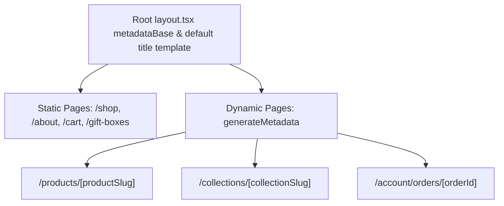

# KRAK & CO. — SEO & Metadata Architecture

**Project:** KRAK & CO. E-Commerce Storefront  
**Phase:** 07 — Next.js Architecture, Folder Structure, Routing & Data Layer  
**Framework:** Next.js 14.2 Metadata API  

---

## 1. Overview & Strategy

KRAK & CO. relies heavily on organic search discovery for high-intent queries such as "authentic Kerala banana chips coconut oil", "Madurai mixture buy online", and "Diwali snack gift box hampers".

The SEO architecture leverages Next.js 14 Server-side Metadata API to generate dynamic, crawlable, and rich OpenGraph/Twitter card tags for every page.

---

## 2. Metadata Hierarchy



### 2.1 Root Layout Defaults (`src/app/layout.tsx`)

```typescript
export const metadata: Metadata = {
  metadataBase: new URL(
    process.env.NEXT_PUBLIC_SITE_URL || "https://krakandco.com"
  ),
  title: {
    default: "KRAK & CO. — Authentic Indian Snacks: South to North",
    template: "%s | KRAK & CO.",
  },
  description:
    "Handcrafted authentic South and North Indian snacks, savouries, mixtures, sweets, and gift hampers. Made with traditional recipes and premium cold-pressed oils.",
  keywords: [
    "Indian snacks online",
    "Kerala banana chips",
    "Madurai mixture",
    "Aloo bhujia",
    "Ragi murukku",
    "Kaju katli",
    "Indian sweets online",
    "Snack gift boxes",
  ],
  openGraph: {
    type: "website",
    locale: "en_IN",
    url: "https://krakandco.com",
    siteName: "KRAK & CO.",
    title: "KRAK & CO. — Authentic Indian Snacks: South to North",
    description: "Traditional recipes, premium ingredients, and irresistible crunch in every bite.",
    images: [{ url: "/assets/brand/identity/reference-artboard.jpg", width: 1200, height: 630 }],
  },
};
```

---

## 3. Dynamic Metadata Resolution

Dynamic product detail pages generate custom OpenGraph metadata on the fly:

```typescript
// src/app/(storefront)/products/[productSlug]/page.tsx
export async function generateMetadata({ params }: ProductPageProps): Promise<Metadata> {
  const product = await productService.getBySlug(params.productSlug);
  if (!product) {
    return { title: "Product Not Found" };
  }

  return {
    title: `${product.name} — ${product.tagline}`,
    description: product.shortDescription,
    openGraph: {
      title: `${product.name} | KRAK & CO.`,
      description: product.shortDescription,
      images: [
        {
          url: product.thumbnailUrl,
          width: 800,
          height: 800,
          alt: product.name,
        },
      ],
    },
  };
}
```

---

## 4. Structured Data (JSON-LD) Specification

For Product and Collection pages, JSON-LD Schema.org markup will be injected during component implementation (Phase 08/09):
- **`Product` Schema:** Includes `name`, `image`, `description`, `sku`, `offers: { price, priceCurrency: "INR", availability }`, and `aggregateRating`.
- **`BreadcrumbList` Schema:** Provides Google search results with hierarchical breadcrumbs (`Home > Shop > Mixtures > Madurai Mixture`).
- **`Organization` Schema:** Establishes the KRAK & CO. brand entity, official logo, and social profile links.
