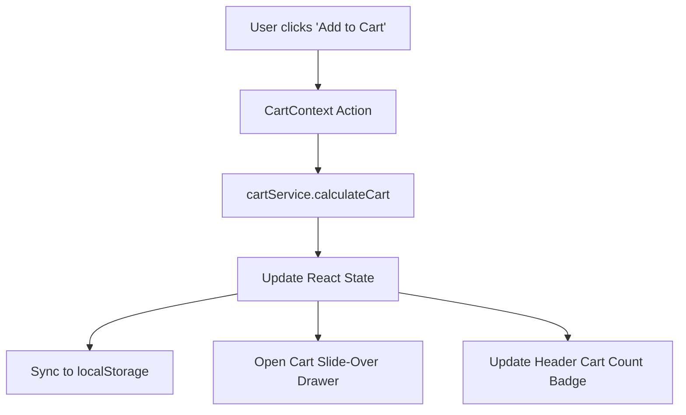

# KRAK & CO. — State Management Architecture

**Project:** KRAK & CO. E-Commerce Storefront  
**Phase:** 07 — Next.js Architecture, Folder Structure, Routing & Data Layer  
**Approach:** Lightweight Context + URL State + Server State (Zero Redux Bloat)  

---

## 1. State Categories & Storage Strategy

E-commerce storefronts require distinct treatment for different tiers of state:

| State Tier | Examples | Storage Mechanism | Rehydration / Persistence |
|---|---|---|---|
| **Server State** | Product catalog, collection taxonomy, customer reviews, order tracking | Next.js Server Components + Fetch Cache | Revalidated on demand or via time-based tags |
| **URL State** | Search keywords (`?q=`), active category (`?cat=`), price sorting (`?sort=price_asc`), page number | `next/navigation` (`useSearchParams`, `useRouter`) | Deep linkable, bookmarkable, preserves back-button history |
| **Session Cart State** | Cart line items, selected pack weights, applied coupon codes, drawer visibility | React Context (`CartContext`) + `localStorage` | Persisted across page refreshes and browser tabs |
| **Customer Auth State** | User token, profile info, default shipping address | React Context (`AuthContext`) + Secure Cookies / Storage | Cleared on sign out; synced with account routes |
| **Ephemeral Local State** | Image gallery carousel index, accordion expanded state, modal open/close | `useState`, `useReducer` inside Client Components | Garbage collected on component unmount |

---

## 2. Cart State Architecture

The cart state is designed to operate seamlessly across both server and client:



### Free Shipping Calculation Engine
The cart service computes the free shipping progression on every mutation:
- Free shipping threshold: **₹499**.
- If `subtotal >= 499`: `shipping = 0`, `freeShippingEligible = true`.
- If `subtotal < 499`: `shipping = 49`, `amountNeededForFreeShipping = 499 - subtotal`.

This drives the conversion-optimized progress bar in the cart drawer ("Add ₹X more for Free Shipping!").

---

## 3. URL State Management Pattern

Filtering and sorting on `/shop` and `/search` are driven entirely through URL query parameters:

```typescript
// Example: Updating filter without full page reload
const router = useRouter();
const searchParams = useSearchParams();

function handleFilterChange(key: string, value: string) {
  const params = new URLSearchParams(searchParams.toString());
  if (value) {
    params.set(key, value);
  } else {
    params.delete(key);
  }
  router.push(`/shop?${params.toString()}`, { scroll: false });
}
```

**Benefits:**
- Users can share URLs containing active filters.
- Browser back and forward buttons navigate filter states naturally.
- Zero client-side sync bugs.
